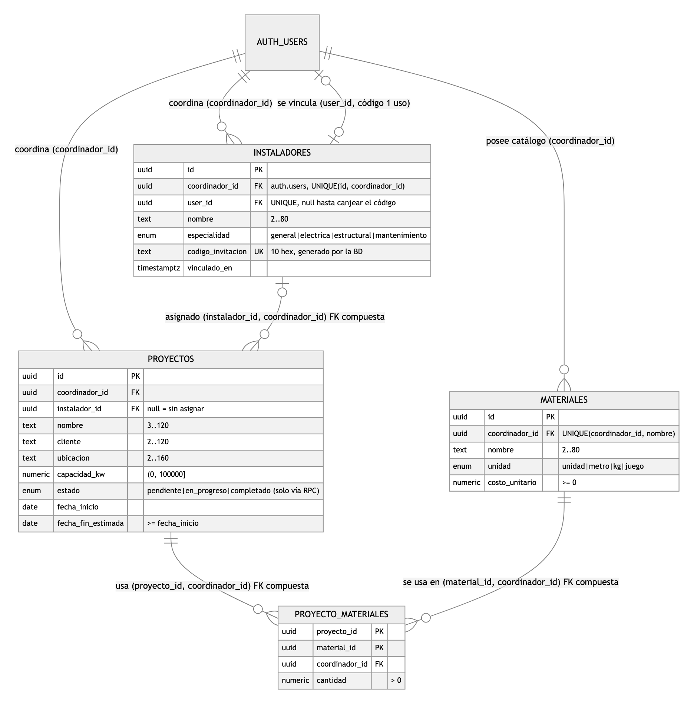

# Documento de Arquitectura — EcoFlow (Proyecto Final Integrador)

> Plataforma interna de EcoFlow para gestionar proyectos de instalación de paneles solares.
> React 19 + TypeScript estricto + Vite 8 + Tailwind v4 · Supabase (Postgres 17, RLS, RPC) · Repositorio:
> https://github.com/Juanseom/project-ia-architect (tag `ecoflow`). Todas las cifras salen de comandos versionados.

## 1. Proceso: arquitectura basada en especificaciones

| Paso | Artefacto | Qué controla |
|---|---|---|
| 1. Especificación | [`prompts/08-prompt-maestro-ecoflow.md`](prompts/08-prompt-maestro-ecoflow.md) | Roles, estados/transiciones, esquema, RLS y criterios EF-01..EF-07 **antes** del código |
| 2. Base de datos | [`prompts/09-esquema-rls-ecoflow.md`](prompts/09-esquema-rls-ecoflow.md) → `supabase/migrations/20261106234923_ecoflow_esquema.sql` | FKs compuestas, políticas, RPCs, vista de resumen |
| 3. Verificación SQL | `supabase/tests/ecoflow_rls.sql` → `evidencias/ecoflow/rls-psql.txt` | 4 actores, 9 rechazos esperados |
| 4. Frontend | [`prompts/10-frontend-ecoflow.md`](prompts/10-frontend-ecoflow.md) → dominio, servicio, hooks, componentes, páginas | Capas, tipos, accesibilidad, bundle |
| 5. Verificación E2E | `scripts/ecoflow-evidence.mjs` → `evidencias/ecoflow/e2e-log.txt` | 3 usuarios reales contra Supabase |

El prompt maestro funciona como contrato: los prompts 09 y 10 lo citan, y cualquier respuesta de la IA que lo contradijera
se rechazaba (ver §6). EcoFlow entra como **dominio nuevo** sobre la arquitectura existente (regla de escalabilidad del
repo): `types/project.ts` + `projects.service.ts` + hooks + `components/projects|team` + 2 páginas + 1 migración,
reutilizando auth, router con `React.lazy`, manejo de errores, guards de seguridad y la infraestructura de tests.

## 2. Diagrama de la base de datos



Fuente versionada (Mermaid, se renderiza en GitHub): [`diagrama-er-ecoflow.mmd`](diagrama-er-ecoflow.mmd).

Decisiones del esquema:
- **Integridad multi-tenant en la BD, no en la UI.** `UNIQUE (id, coordinador_id)` en instaladores, materiales y proyectos
  permite FKs **compuestas**: un proyecto solo puede referenciar instaladores/materiales del **mismo** coordinador.
  `ON DELETE SET NULL (instalador_id)` (Postgres ≥ 15) desasigna sin borrar `coordinador_id`.
- **N:M con datos** (`proyecto_materiales.cantidad`) en vez de un arreglo: consultable, con FK y `CHECK (cantidad > 0)`.
- **ENUMs** para valores cerrados (estado, especialidad, unidad) y **CHECK** de longitudes/rangos idénticos a la validación del frontend.
- **Índices** en todas las FKs y en las columnas que usan las políticas (`coordinador_id, estado`, `instalador_id`, `user_id` único).
- `estado` solo cambia por RPC; `updated_at` por trigger; límite de 30 proyectos/min por coordinador (`PT429` → HTTP 429).

## 3. Seguridad: roles derivados y RLS

Los roles **no son una columna editable** (lección de MentorLink: asignar rol desde `raw_user_meta_data` permitía escalar privilegios):
- **Coordinador** = dueño de su espacio (`coordinador_id = auth.uid()`).
- **Instalador** = usuario cuyo `user_id` quedó en una fila de `instaladores` al canjear un **código de un solo uso** generado por la BD.

| Objeto | Regla | Justificación |
|---|---|---|
| `anon` | `revoke all` en las 4 tablas y la vista | La anon key es pública; sin sesión no hay datos |
| Grants | Por columna; `estado`, `coordinador_id`, `user_id`, `codigo_invitacion` sin grant | El cliente no puede fijar dueño, rol ni estado |
| `proyectos` SELECT | `coordinador_id = (select auth.uid())` **o** `instalador_id in (instaladores donde user_id = auth.uid())` | Requisito central: cada instalador ve solo sus proyectos asignados |
| `proyectos` INSERT/UPDATE/DELETE | Solo coordinador dueño | El instalador no edita datos del proyecto |
| `instaladores` SELECT | Coordinador ve su equipo; instalador solo su ficha | No se filtran compañeros ni otros equipos |
| `materiales` SELECT | Coordinador: catálogo; instalador: solo materiales de sus proyectos | Mínimo privilegio |
| `proyecto_materiales` SELECT | Si el proyecto es visible (hereda RLS de proyectos) | Sin reglas duplicadas |
| `cambiar_estado_proyecto` | SECURITY DEFINER + `search_path=''`; valida actor y transición | Única vía para `estado`; mismo error si el proyecto es ajeno o no existe |
| `vincular_instalador` | SECURITY DEFINER; un solo uso; mismo error para inexistente/usado | No permite enumerar códigos |
| `crear_proyecto` | SECURITY **INVOKER**, transaccional | Atómica (proyecto + materiales) **respetando** RLS y grants |
| `proyectos_resumen` | Vista `security_invoker` | El conteo por estado de cada usuario respeta su RLS |

Transiciones (BD = autoridad; `allowedTransitions()` en el frontend es un espejo probado):
`pendiente → en_progreso` (requiere instalador) · `en_progreso → completado | pendiente` · `completado → en_progreso` (solo coordinador).

Verificación (`supabase/tests/ecoflow_rls.sql`, transacción con ROLLBACK):
```
EF-01  A (coordinador) ve 2 · B (instalador asignado) ve "Granja Solar Norte" · C (no asignado) 0 · D (otro coordinador) 0 · anon: ningún privilegio
EF-02  D usa el id del instalador de A → violates foreign key constraint "proyectos_instalador_fkey"
       D usa un material de A en crear_proyecto → FK de proyecto_materiales y 0 proyectos de D (atómico)
EF-03  C mueve la Granja → "Proyecto no encontrado." · B pendiente→completado → "Transición no permitida"
       B UPDATE directo de estado → permission denied · A inicia sin instalador → "Asigna un instalador…"
EF-04  B canjea el código de Ana (en minúsculas) → vinculado · D reutiliza → "Código inválido o ya utilizado." (igual que uno inventado)
EF-06  Resumen de A: pendiente 1 / 35 kW, en_progreso 1 / 120,5 kW · resumen de B: solo su proyecto
```

## 4. Estructura del frontend

```
src/types/project.ts            Project, ProjectStatus, Installer, Material, NewProject, ProjectsState (unión discriminada)…
src/utils/projects.ts           validateProject (mismas reglas que los CHECK), allowedTransitions, summarizeProjects, formatos es-CO
src/services/projects.service.ts  ProjectsService + implementación Supabase (embeds tipados, RPCs) → mapeo snake_case → camelCase
src/services/projects.mock.ts   misma interfaz en memoria (modo demo y tests; no viaja en el bundle de producción)
src/hooks/useProjects.ts        estado, filtro, tablero agrupado (useMemo), cambio de estado con ids pendientes, creación
src/hooks/useTeam.ts            instaladores, catálogo, membresía y vinculación por código
src/hooks/useProjectForm.ts     valores, errores por campo, filas de materiales, foco al primer inválido
src/components/projects/        ProjectsSummaryPanel, StatusFilter, ProjectBoard → ProjectCard (memo), ProjectForm, ProjectsLoading
src/components/team/            InstallerList, InstallerForm, MaterialList, MaterialForm, JoinTeamForm
src/pages/ProjectsPage.tsx      /proyectos (React.lazy)        src/pages/TeamPage.tsx   /equipo (React.lazy)
```
Flujo: `ProjectsPage → useProjects / useTeam / useProjectForm → projectsService → getSupabase() (SDK dinámico) → RPC/tablas (RLS)`.
Reglas verificadas por `oxlint`: los componentes no importan hooks/services; solo `services/` importa `@supabase/supabase-js`.
UI: Tailwind v4 (sin librerías nuevas), tablero 1→3 columnas, skeletons, vacío con CTA, errores con `role="alert"`,
éxito por `aria-live`, foco al primer campo inválido, botones `aria-disabled` durante acciones, contraste AA.

## 5. Tipos de TypeScript generados con IA

`npm run db:types` (`supabase gen types typescript --local`) generó `database.types.ts` desde el esquema real: tablas, la vista,
los ENUMs y las firmas de las 3 RPC. Con esos tipos, los **embeds de PostgREST** por las FKs compuestas
(`instalador:instaladores!proyectos_instalador_fkey(id, nombre)`) quedan tipados sin un solo cast.
Hallazgo al revisarlos (control de diseño, no copiar y pegar): **los tipos describen el esquema, no los privilegios** —
`Insert` de `proyectos` acepta `estado` y `coordinador_id`, que la BD rechaza. Por eso la UI nunca usa esos tipos:
el servicio expone `NewProject` (sin estado ni dueño) y crea por la RPC. Resultado: 0 `any` y 0 casts que silencien errores.

## 6. Uso de IA para un problema técnico complejo

**Problema: el dominio nuevo inflaba la carga inicial de toda la app.** Al agregar EcoFlow, el build mostró que el chunk inicial pasó
de 30,98 kB a **54,14 kB**, aunque `/proyectos` y `/equipo` eran rutas `React.lazy` (sus chunks pesaban apenas 2-3 kB: el código
no estaba en ellos). Diálogo con la IA, con evidencia en cada paso:
1. *Diagnóstico pedido con datos, no a ojo*: reporte de `rollup-plugin-visualizer` filtrado al chunk inicial → ~50 kB de EcoFlow
   (ProjectForm 9,6 kB, projects.service 5,4 kB, useTeam 3,9 kB…).
2. *Causa*: `EmissionsTracker` (ruta eager) importa los barrels raíz `../components` y `../hooks`, que re-exportan EcoFlow; sin
   garantía de que esos módulos no tengan efectos secundarios, el bundler los coloca en el chunk de entrada.
3. *Alternativas evaluadas*: (a) imports a archivos internos — rompe la regla de barrels del repo; (b) **declarar el paquete sin
   efectos secundarios** (`"sideEffects": ["**/*.css"]` en package.json). Se eligió (b): mantiene la arquitectura.
4. *Resultado medido*: chunk inicial **30,18 kB** (menor que antes de EcoFlow); EcoFlow en `ProjectsPage` 17,2 kB, `TeamPage` 8,7 kB
   y `useTeam` 10,4 kB compartido, descargados solo al navegar.
   Reproducible con el código final: `evidencias/ecoflow/bundle-sin-sideeffects.txt` (index 54,48 kB) vs `bundle-con-sideeffects.txt` (30,18 kB).

Otros problemas reales resueltos en esta fase (también con evidencia):
- **Prueba falsa positiva**: mi primera prueba EF-02 fallaba por un CHECK (`cliente = 'X'`), no por la FK; se corrigió el dato y se demostró la FK.
- **Test de fechas sin sentido**: corría en UTC, donde el bug de "un día menos" no aparece; se fijó `TZ=America/Bogota` (offset 300 → sin `timeZone: 'UTC'` mostraría "31 oct").
- **Accesibilidad**: el resumen se leía "2115 kW" (conteo y kW pegados); se agregó texto para lectores ("2 proyectos, 115 kW") con test.
- **Revisión visual**: marca "EcoTrack" en páginas de EcoFlow, fechas partidas en 4 líneas y tablero apretado → marca por ruta, formato compacto, contenedor más ancho.
- **Control del diseño desde la especificación**: el patrón habitual de una columna `rol` en un perfil editable quedó excluido desde el prompt maestro (lección de MentorLink); los roles se derivan de datos que el cliente no controla y el canje de código es la única vía para ser instalador.

## 7. Verificación final

`tsc -b` exit 0 · `oxlint` exit 0 (capas + jsx-a11y) · **116/116 tests** (15 archivos; EcoFlow: validación, transiciones, hooks con
mock, formulario accesible, resumen accesible, ruta perezosa) · build OK · `db:lint` sin errores · `db reset` reaplica 6 migraciones ·
`ecoflow_rls.sql` + regresiones de `rls_emisiones.sql` y `hardening_lab5.sql` OK · E2E con 3 usuarios (`e2e-log.txt`):
B ve 1 proyecto, C ve 0, código reutilizado rechazado, móvil 390 px y tablet sin scroll horizontal, consola sin errores.

## 8. Ejecutar y grabar la demo

```bash
npm install && npm run db:start          # Supabase local (Docker); Studio en http://127.0.0.1:54323
cp .env.example .env                     # URL + anon key de `npm run db:status`
npm run dev                              # http://localhost:5173/proyectos
node scripts/ecoflow-evidence.mjs        # E2E + capturas en docs/evidencias/ecoflow/
```
Guion del video (3-5 min): (1) Studio → Table Editor y Database → Policies de `proyectos`; (2) ventana A: Equipo → crear instaladora
"Ana" y materiales, copiar su código; (3) Proyectos → enviar el formulario vacío (errores + foco) y crear 2 proyectos (uno asignado a Ana
con materiales, otro sin instalador); (4) ventana de incógnito B: Equipo → canjear el código → Proyectos muestra solo el asignado
("Asignado a ti") → "Iniciar instalación"; (5) A recarga: el proyecto pasó a En progreso y el resumen cambió; (6) Studio → Table Editor
muestra `estado = en_progreso` y `user_id` de Ana vinculado; SQL Editor con `select * from proyectos_resumen`; (7) cierre con `npm test`.
